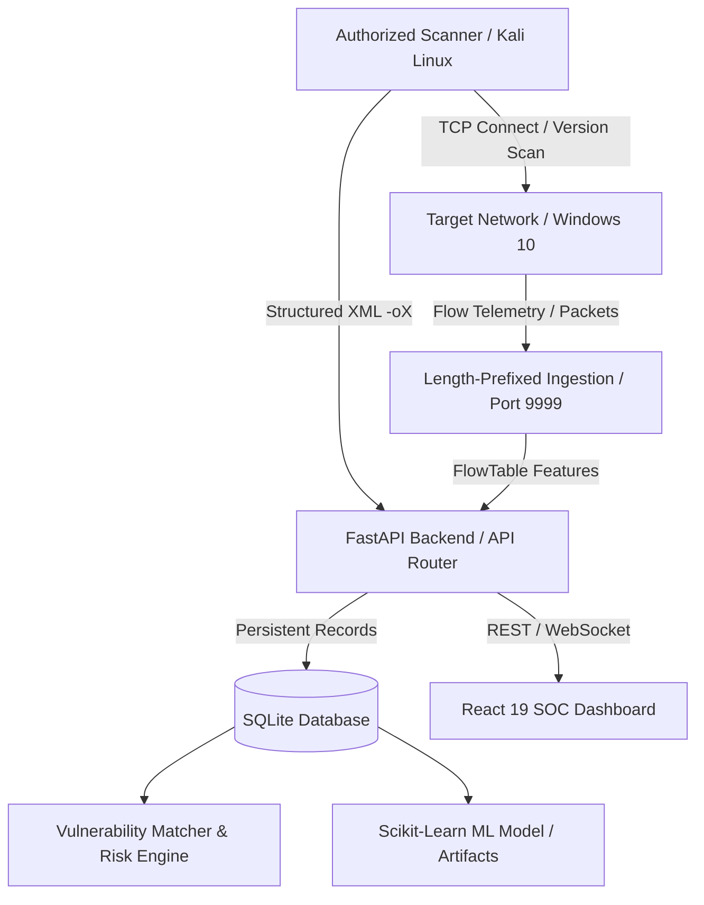

# Nmap-AI Security Intelligence Platform

[](https://www.python.org/)
[](https://fastapi.tiangolo.com/)
[](https://react.dev/)
[](https://tailwindcss.com/)
[](LICENSE)

An evidence-based cybersecurity intelligence platform integrating network host discovery, structured Nmap port scanning, non-destructive vulnerability correlation, live packet flow telemetry, and supervised machine-learning intrusion detection.

Built specifically for authorized penetration testing labs, SOC analyst workflows, and applied machine learning research.

---

## Key Highlights & Core Tenets

### 1. Evidence-Based Security (Zero Fabrication)
- **Traceable Provenance**: Every metric, host, open port, vulnerability finding, and alert is derived from verified SQLite database records populated by real scanner output (`-oX scan.xml`) or live flow packets.
- **Strict Distinction**:
  - `Observed`: Present directly in scanner banner or captured flow.
  - `Detected`: Produced by signature or classifier.
  - `Suspected`: Correlated banner without verified check.
  - `Confirmed by Check`: Safe non-destructive script explicitly verified vulnerability.
  - `Validated Vulnerability`: Product, version, and configuration definitively match verified CVE.
  - `Exploitation`: Never claimed without independent authorized evidence.
- **Strict Demo Mode Isolation**: Demo fixtures are clearly labeled (`data_source='demo'`) and never pollute live operational records without an explicit UI toggle.

### 2. Full-Stack SOC-Grade Architecture
- **Backend**: FastAPI with async lifespan, SQLAlchemy ORM, SQLite/PostgreSQL persistence, and Pydantic v2 validation contracts.
- **Frontend**: React 19, TypeScript, Vite, Tailwind CSS v4, Lucide Icons, and Recharts dark-theme visual analytics.
- **Interactive Topology**: SVG-based dynamic topology graph showing actual scan relationships between authorized scanner (Kali) and targets (Windows 10).
- **Scan Management**: Safe process execution via argument arrays (`argv`), strict target validation against an authorized CIDR allowlist, command preview, and live progress tracking.
- **Vulnerability Intelligence**: Correlation engine mapping discovered services to known CVEs with CVSS severity, evidence payload, and analyst triage workflow (`new`, `investigating`, `confirmed`, `false_positive`, `accepted_risk`, `resolved`).

### 3. Machine Learning Lab (Scikit-Learn)
- **Trained on Benchmark Flow Telemetry**: Uses CIC-IDS2017 PortScan dataset with 10 normalized flow features (`Destination Port`, `Flow Duration`, `Total Fwd Packets`, `Total Backward Packets`, `Total Length of Fwd Packets`, `Fwd Packet Length Max`, `Bwd Packet Length Max`, `Flow Bytes/s`, `Flow Packets/s`, `Average Packet Size`).
- **Reproducible Pipeline**: Evaluated on stratified test splits yielding **99.75% Macro F1** and **99.75% Balanced Accuracy**.
- **Full Model Transparency**: Confusion matrix visualization, per-class metrics, feature importance rankings, and real-time interactive inference playground.
- **No Fabricated Constants**: Incomplete packet captures are marked `skipped_insufficient` rather than padded with fake metrics.

---

## System Architecture



---

## Directory Structure

```text
Nmap-Ai/
├── backend/                  # FastAPI Application
│   ├── app/
│   │   ├── api/routes/       # Endpoints: scans, hosts, findings, alerts, traffic, ml, reports, settings
│   │   ├── core/             # Configuration, logging, paths, error handlers
│   │   ├── db/               # SQLAlchemy session & init
│   │   ├── demo/             # Isolated demo fixtures & seeders
│   │   ├── models/           # Database entities (ScanJob, Host, Service, Finding, Alert, etc.)
│   │   ├── schemas/          # Pydantic v2 API contracts
│   │   └── services/         # Nmap parser, scan engine, risk engine, reporting
├── frontend/                 # React 19 + TypeScript + Vite Dashboard
│   ├── src/
│   │   ├── components/       # Badges, Cards, Drawers, Modals, Layout
│   │   ├── context/          # AppContext (demo mode, settings, notifications)
│   │   ├── pages/            # 10 SOC Dashboard Pages
│   │   ├── services/         # Typed REST client
│   │   └── types/            # Complete TypeScript interface definitions
├── ml/                       # Machine Learning Pipeline
│   ├── artifacts/            # Versioned .joblib models, schemas, and metrics
│   ├── preprocessing/        # Dataset cleaning and feature schema
│   └── training/             # Stratified train/test script
├── capture/                  # Live telemetry stream monitor
├── dataset/                  # CIC-IDS2017 benchmark dataset files
├── docs/                     # Full technical documentation
│   ├── ARCHITECTURE.md       # Data flow and component boundaries
│   ├── LAB_SETUP.md          # Kali & Windows 10 lab instructions
│   ├── ML_PIPELINE.md        # Feature schemas, leakage controls, metrics
│   ├── THREAT_MODEL.md       # Threat vectors and mitigations
│   ├── API.md                # REST API documentation
│   └── TEST_REPORT.md        # Automated test verification results
└── tests/                    # Automated pytest suite (backend & ML)
```

---

## Quickstart & Installation

### Prerequisites
- Linux / macOS (Kali Linux recommended for active scanning)
- Python 3.12+
- Node.js 20+ & npm 10+
- Nmap (`sudo apt install nmap`) — *optional for offline demo/XML mode*

### 1. Backend Setup
```bash
# Clone repository
git clone https://github.com/vulnanalyst/Nmap-Ai.git
cd Nmap-Ai

# Create virtual environment & install dependencies
python3 -m venv .venv
source .venv/bin/activate
pip install -r backend/requirements.txt

# Copy environment variables
cp .env.example .env

# Run database initialization & API server
python3 main.py
```
The API server will be available at: `http://127.0.0.1:8000` (Swagger docs at `/docs`).

### 2. Frontend Setup
```bash
cd frontend
npm install
npm run dev
```
The SOC Dashboard will be running at: `http://127.0.0.1:5173`.

### 3. Running Automated Tests
```bash
# Run backend & ML test suite
source .venv/bin/activate
pytest -v

# Run frontend production build & TypeScript validation
cd frontend
npm run build
```

---

## Authorized Lab Workflows

1. **Dashboard & Demo Exploration**: Toggle "Demo Mode" in the dashboard header to explore simulated Windows 10 target evidence, SMB/RDP findings, and attack flow telemetry.
2. **Target Scanning**: Configure target CIDRs in `Settings -> Authorized Target Allowlist`. Go to `Scan Management`, select an authorized target, preview the safe argv command, and launch.
3. **XML Artifact Import**: Drag and drop any existing Nmap XML output (`scan.xml`) in `Scan Management` to populate hosts and findings.
4. **Machine Learning Retraining**: Visit the `AI / ML Lab` page to inspect confusion matrices, evaluate custom 10-feature flow vectors in the Playground, or trigger retraining.
5. **Executive Evidence Export**: Generate signed JSON and PDF compliance reports in `Evidence Reports`.

---

## License

This project is licensed under the MIT License. See [LICENSE](LICENSE) for details.
