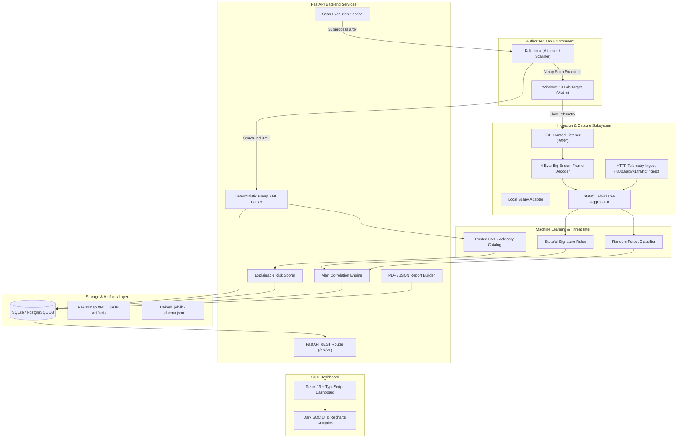

# System Architecture — Nmap-AI Security Intelligence Platform

## 1. Architectural Philosophy

The **Nmap-AI Security Intelligence Platform** is built on **Evidence-First Security**. In conventional security dashboards, synthetic charts and unverified CVE alerts frequently mislead operators. This platform enforces a strict data provenance boundary: every metric, host, port state, and vulnerability finding displayed on the dashboard must be traced directly to an underlying database record created from verified scanner output or live telemetry.

---

## 2. Component Diagram

---

## 3. Data Flow & Provenance Lifecycle

### A. Scanning & Discovery Lifecycle
1. **Target Validation**: Operator submits target IP or CIDR. The backend verifies target against the persistent `authorized_targets` table. Unauthorized targets are rejected with HTTP 403.
2. **Safe Command Execution**: Arguments are formatted into a deterministic array:
   `["nmap", "-sT", "-sV", "--stats-every", "5s", "-oX", xml_path, target]`.
   Subprocesses are launched with process isolation, strict timeouts (default 600s), and zero shell string interpolation (`shell=False`).
3. **Structured XML Parsing**: Nmap output is parsed using Python's `xml.etree.ElementTree`. Raw XML is stored immutably in `data/scans/<scan_id>/scan.xml`.
4. **Relational Normalization**:
   - `Host` records store IP, hostname, MAC vendor, and state. OS guesses are explicitly tagged as guesses.
   - `Service` records store port, protocol, state (`open`, `closed`, `filtered`), product, and version.
   - Port deduplication ensures idempotency on repeated imports.

### B. Vulnerability Correlation & Risk Scoring
1. **Banner Correlation**: Extracted service product banners are checked against the local vulnerability catalog (`ml/catalog/cve_catalog.json`) using affected version ranges.
2. **Validation States**:
   - `validated_vulnerability`: Specific service and version range match verified CVE.
   - `confirmed_by_check`: A safe script (e.g. `smb2-security-mode`) explicitly demonstrated the misconfiguration.
   - `potential_issue`: Service banner matches a known vulnerable product family but configuration is unconfirmed.
   - `no_verified_cve_match`: Service observed open, but no CVE exists in the catalog.
3. **Risk Formula**:
   $$\text{Risk} = (0.45 \cdot \text{CVSS} + 0.25 \cdot \text{Exposure} + 0.15 \cdot \text{Confidence} + 0.15 \cdot \text{ML Anomaly}) \cdot \text{Freshness}$$

### C. Flow Telemetry & ML IDS Lifecycle
1. **Framed Ingestion**: Telemetry sent over TCP port 9999 is framed using a 4-byte big-endian length prefix `[Length (4B)][Payload (NB)]` to prevent stream chunk corruption.
2. **Flow Aggregation**: `FlowTable` tracks bidirectional packet counts, lengths, and timing across `(src_ip, dst_ip, src_port, dst_port, protocol)`.
3. **ML Classification**: If flow contains sufficient packets, features are extracted matching the 10-feature schema of CIC-IDS2017. If insufficient, it is marked `skipped_insufficient` to avoid deceptive predictions.

---

## 4. Security & Trust Boundaries

| Boundary | Enforcement Mechanism |
|----------|-----------------------|
| Scanner Execution | Array-based `subprocess.Popen` (`shell=False`), timeout watchdog, no arbitrary shell arguments. |
| Target Scope | Pre-configured `authorized_targets` CIDR checks in database before process spawn. |
| Network Telemetry | Dedicated length-prefixed stream decoding; frame length capped at 65,535 bytes to prevent DoS. |
| Authentication | `X-API-Key` token header validation on all non-public endpoints. |
| Local Binding | Development servers bind to `127.0.0.1` by default; no open internet exposure. |
| Data Isolation | Simulated lab records are tagged `data_source='demo'` and strictly filtered out of operational queries. |
